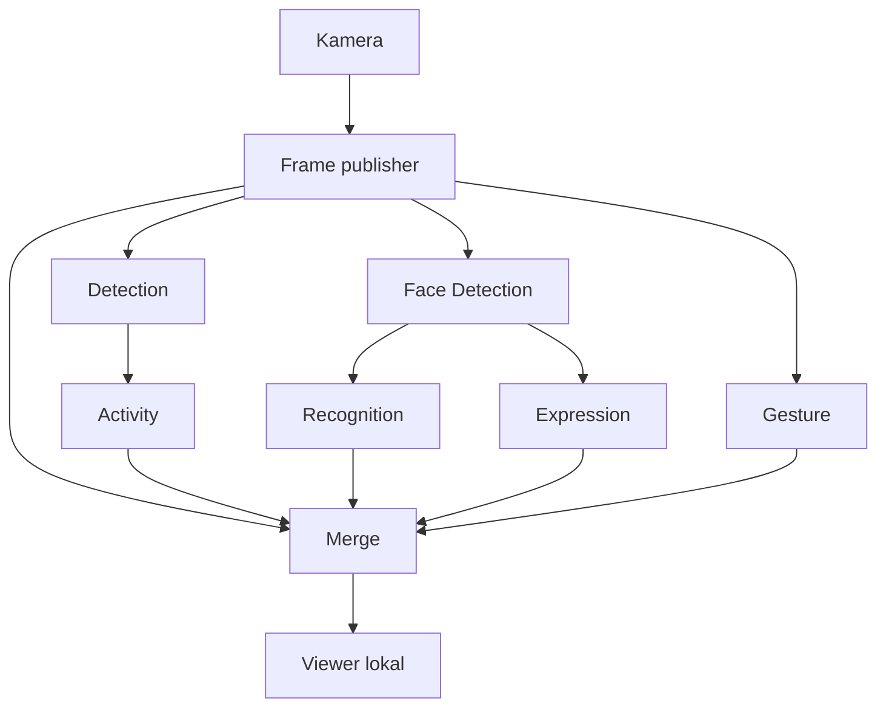

# Smart Classroom Management System

**Smart Classroom Management System Berbasis Web dan Mobile untuk Monitoring Kehadiran, Jadwal, dan Aktivitas Perkuliahan**

Proyek Capstone Informatika, Universitas Trisakti. Repositori ini memuat workspace ROS 2 untuk subsistem computer vision (CV), viewer lokal, serta instrumen dan data pengujian pendahuluan pada PC. Status dokumentasi: **24 Oktober 2026**.

Pengembangan menggunakan fondasi pipeline CV dan dashboard dari proyek angkatan sebelumnya. Pekerjaan yang telah dilaporkan kelompok mencakup verifikasi fungsi node, instrumentasi waktu callback, pengujian jalur keluaran lokal, dan diagnosis keterlambatan antartahap.

## Tim

- Hafidz Ramadhan
- Muhammad Hakim
- Arik Dias
- Juniarto Prabowo
- M. Fadly Febrian

## Ruang lingkup dan status

| Bagian | Status yang telah dilaporkan |
| --- | --- |
| Delapan node utama CV | Sudah diperiksa secara fungsional. Pengujian ini belum membuktikan semua cabang berjalan bersamaan dengan kinerja yang memadai. |
| Waktu pekerjaan enam modul analisis | Baseline callback tersedia dalam CSV dan log. |
| Aliran frame | Laju penerimaan dan interval antarpesan pernah diukur. |
| Merge dan viewer lokal | Hasil analisis pernah tampil. Keterlambatan dan penurunan kualitas gambar masih menjadi kendala. |
| Diagnosis Detection ke Activity | 41 pasangan crop berhasil dicocokkan menggunakan CSV asli. Hasil dirangkum di bawah. |
| Dashboard web | Fondasi sebelumnya tersedia; verifikasi lokal dan integrasi baru belum dikonfirmasi dalam laporan ini. |
| Aplikasi mobile dan fitur jadwal | Progres implementasi belum dikonfirmasi dalam laporan ini. |
| Kehadiran | Pengenalan identitas pernah diuji; alur lengkap sampai pencatatan absensi belum terverifikasi. |
| Raspberry Pi 5 | Pengujian belum dilakukan. Penyimpanan untuk deployment masih disiapkan. |
| Buffer keluaran adaptif | Belum diimplementasikan dan belum diuji efektivitasnya. |

Status “belum dikonfirmasi” menunjukkan keterbatasan laporan yang tersedia, bukan kepastian bahwa anggota tim belum mengerjakannya.

## Arsitektur subsistem CV

Alurnya bercabang. Activity menerima crop orang dari Detection. Recognition dan Expression menerima crop wajah dari Face. Merge menerima gambar dari Frame serta hasil analisis dari cabang terkait.



Pada kode `merge_test` yang ditinjau, topik crop person dari Detection tidak langsung masuk ke Merge. Jalur lokal Gesture–Merge–viewer dan Activity–Merge–viewer sudah pernah dicoba. Integrasi sampai dashboard belum dilaporkan terverifikasi.

### Delapan node utama

| Executable | Fungsi |
| --- | --- |
| `frame` | Memperoleh dan menerbitkan frame kamera beserta identitasnya. |
| `detection` | Mendeteksi objek dan menerbitkan crop orang untuk cabang Activity. |
| `face` | Mendeteksi wajah dan menghasilkan crop untuk analisis berikutnya. |
| `recognition` | Memproses identitas wajah. |
| `expression` | Memproses ekspresi wajah. |
| `activity` | Memproses aktivitas dari crop orang. |
| `gesture` | Memproses gesture. |
| `merge` / varian `merge_test` | Menggabungkan gambar dengan hasil analisis yang terkait. |

`attendance` dan `activate` juga terdaftar di package, tetapi tidak termasuk hitungan delapan node utama di atas. Viewer menjadi node ROS saat dijalankan. Varian `*_debug` merupakan entry point instrumentasi, bukan fungsi produk tambahan.

### Topik yang digunakan dalam pengujian

| Topik | Tipe / isi | Fungsi |
| --- | --- | --- |
| `/cv/frame` | `smartclass_msgs/msg/FrameCv` | Gambar dan metadata frame. |
| `/cv/stream` | `std_msgs/msg/Int64` | Nomor urut; **bukan gambar**. |
| `/cv/bondingbox/person` | `smartclass_msgs/msg/BondingBoxCv` | Crop orang dan metadata hasil Detection. |
| `/cv/bondingbox/activity` | `smartclass_msgs/msg/BondingBoxCv` | Hasil Activity. |
| `/cv/bondingbox/face_identity` | `smartclass_msgs/msg/BondingBoxCv` | Hasil identitas wajah untuk Merge. |
| `/cv/bondingbox/face_emotion` | `smartclass_msgs/msg/BondingBoxCv` | Hasil ekspresi untuk Merge. |
| `/cv/bondingbox/gesture` | `smartclass_msgs/msg/BondingBoxCv` | Hasil gesture untuk Merge. |
| `/cv/frame/image` | `sensor_msgs/msg/CompressedImage` | Gambar keluaran `merge_test` untuk viewer. |
| `/cv/frame/result` | `smartclass_msgs/msg/ResultCv` | Hasil gabungan terstruktur dari `merge_test`. |

Ejaan `bondingbox` mengikuti nama pada source dan interface proyek.

## Lingkungan pengujian

| Komponen | Baseline PC / target |
| --- | --- |
| CPU dan RAM PC | Intel i7-3770, RAM 16 GB |
| GPU terpasang | RX 580 4 GB; penggunaan GPU untuk inferensi belum dibuktikan |
| Sistem pengujian | WSL, Ubuntu 24.04, ROS 2 Jazzy |
| Virtual environment | `/home/hafidz/smartclass_ws/.venv` |
| Kamera PC | Hikvision DS-U02 |
| Provider Activity yang tercatat | ONNX Runtime 1.30.0, `CPUExecutionProvider` |
| Target perangkat | Raspberry Pi 5 RAM 8 GB, kamera JETE PTZ |

Model dan jalur file bergantung pada source masing-masing node. Contohnya, source Activity yang dipakai pada diagnosis memuat `models/best.onnx` melalui path absolut di workspace Hafidz. Nama file model saja tidak membuktikan bahwa dua node menggunakan model dan konfigurasi yang identik.

## Struktur repositori

| Lokasi | Isi |
| --- | --- |
| `src/smartclass_msgs/` | Definisi pesan ROS 2 khusus proyek. |
| `src/smartclass_cv/smartclass_cv/` | Implementasi node dan probe yang terintegrasi ke package. |
| `src/smartclass_cv/models/` | Berkas model yang dirujuk konfigurasi package. |
| `src/smartclass_cv/setup.py` | Pendaftaran executable ROS 2 dan model package. |
| `experiments/` | CSV, log, metadata, dan sebagian source alat ukur. |
| `debug_viewer.py` | Viewer frame langsung dan box person dengan pencocokan `frame_id`. |
| `debug_viewer_match_20261016_220250_623971.py` | Varian debug viewer dengan log pencocokan identitas. |
| `merge_viewer.py` | Viewer gambar keluaran Merge. |
| `merge_viewer_baseline_probe.py` | Instrumen untuk pengamatan viewer. |

## Menjalankan pada workspace PC yang sudah dikonfigurasi

Perintah berikut mengikuti lingkungan praktik Hafidz. Ini bukan panduan instalasi lengkap untuk komputer baru. ROS 2, kamera, dependensi Python, interface pesan, dan model harus sudah tersedia. Beberapa path pada source masih spesifik komputer pengembang.

### 1. Siapkan setiap terminal

```bash
source /opt/ros/jazzy/setup.bash
source /home/hafidz/smartclass_ws/install/setup.bash
source /home/hafidz/smartclass_ws/.venv/bin/activate
cd /home/hafidz/smartclass_ws
```

Aktivasi venv tidak otomatis mengubah interpreter pada executable `ros2 run` yang telah dibuat saat build. Jika terjadi error dependensi, periksa interpreter executable dan lingkungan build yang digunakan.

Setelah perubahan package atau entry point, lakukan build pada lingkungan yang sesuai:

```bash
colcon build --symlink-install --packages-select smartclass_msgs smartclass_cv
source /home/hafidz/smartclass_ws/install/setup.bash
```

### 2. Jalankan jalur dasar secara bertahap

Setiap perintah node berikut dijalankan pada terminal tersendiri yang sudah disiapkan.

```bash
# Terminal 1: sumber frame
ros2 run smartclass_cv frame
```

```bash
# Terminal 2: deteksi objek / crop orang
ros2 run smartclass_cv detection
```

```bash
# Terminal 3: analisis aktivitas
ros2 run smartclass_cv activity
```

Periksa node aktif dari terminal tambahan:

```bash
ros2 node list
```

Hentikan proses dengan `Ctrl+C`. Catat node yang aktif saat setiap eksperimen berlangsung.

### 3. Pilih titik tampilan

Untuk melihat frame langsung dan box person:

```bash
python3 debug_viewer.py
```

Viewer ini hanya menggambar box ketika `frame_id` box cocok dengan frame terbaru. Video yang lancar dengan box tidak terlihat dapat terjadi bila hasil analisis datang setelah frame tersebut berganti.

Untuk jalur keluaran Merge, setelah node masukan terkait berjalan:

```bash
# Terminal tambahan: varian Merge yang dipakai pada pengujian lokal
ros2 run smartclass_cv merge_test
```

```bash
# Terminal tambahan: tampilkan keluaran Merge
python3 merge_viewer.py
```

`merge_test` memiliki perilaku debug dan pekerjaan tambahan, termasuk kompresi serta penyimpanan gambar. Jangan menyamakannya dengan konfigurasi produksi yang sudah dioptimalkan. Jendela viewer membutuhkan lingkungan GUI yang berfungsi dan pesan gambar yang benar-benar diterima.

## Instrumentasi dan cara membaca hasil

Callback adalah fungsi yang dijalankan saat node memproses pesan. Probe mencatat waktu masuk dan keluar fungsi asli, identitas pesan, serta status pemrosesan. Batas ukur setiap probe perlu dibaca pada source dan metadata run.

Entry point instrumentasi yang terdaftar:

- `detection_debug`
- `recognition_debug`
- `expression_debug`
- `gesture_debug`

Probe Face dan Activity juga disimpan di `experiments/`. Sebagian diagnosis terakhir dijalankan melalui skrip terminal sementara; versi lengkap instrumen tersebut belum seluruhnya tercatat pada metadata.

Rumus durasi callback:

```text
total_ms = (callback_end_ns - callback_start_ns) / 1.000.000
```

- **N callback**: jumlah pemanggilan yang tercatat. Ini bukan FPS.
- **Median**: nilai tengah durasi yang telah diurutkan.
- **P95**: persentil ke-95 untuk menggambarkan bagian lambat distribusi. Analisis diagnosis terbaru memakai interpolasi linear pada posisi `(N - 1) × 0,95` dengan indeks mulai 0.
- **Frame unik**: jumlah identitas frame yang berbeda. Satu frame dapat menghasilkan beberapa crop dan beberapa callback.
- **Status `ok`**: callback selesai tanpa exception yang dicatat probe. Ini bukan bukti label model benar.

Gunakan clock monotonic untuk durasi. Pemeriksaan sebelumnya menemukan tiga lompatan jam sistem, total sekitar 6,709 detik. Timestamp kalender dan nomor urut dipakai sebagai identitas/konteks, bukan pengganti durasi monotonic.

## Baseline pendahuluan enam modul pada PC

Tabel memakai seluruh sampel termasuk callback pertama. Hasil berasal dari pengujian terpisah dengan masukan dan kondisi beban yang berbeda. Angka tidak menunjukkan end-to-end delay atau perbandingan antar-modul yang sudah dikontrol.

| Modul / data | N callback | Median (ms) | P95 (ms) | File CSV di `experiments/` |
| --- | ---: | ---: | ---: | --- |
| Detection run 02 | 455 | 358,350 | 453,741 | `detection_pc_hikvision_run02.csv` |
| Face Detection | 247 | 679,645 | 982,734 | `face_pc_hikvision_13714347236728.csv` |
| Activity | 278 | 618,841 | 813,364 | `activity_pc_hikvision_2408765625041.csv` |
| Expression | 77 | 2.124,211 | 2.639,257 | `expression_pc_hikvision_11467902022263.csv` |
| Recognition | 204 | 346,388 | 423,892 | `recognition_pc_hikvision_13253283618281.csv` |
| Gesture | 1.932 | 78,612 | 105,939 | `gesture_pc_hikvision_14386616741255.csv` |

Angka tabel mengikuti rekap baseline yang telah digunakan dalam praktik. Detection juga memiliki run lengkap 4.272 callback. Alasan khusus perbedaan run belum tercatat lengkap; jangan menganggapnya ulangan terkontrol atau memilih hasil terbaik tanpa dasar. Statistik tanpa callback pertama, bila disajikan, merupakan analisis tambahan. Sampel pertama tetap dipertahankan.

Expression memiliki median callback tertinggi pada tabel ini. Hal tersebut belum membuktikan penggunaan CPU/RAM tertinggi atau kontribusi terbesar terhadap delay seluruh sistem.

Pengamatan lain:

- Observer mencatat 5.396 pesan frame dan 5.402 pesan stream, dengan rata-rata penerimaan sekitar 30,024 dan 30,025 pesan/detik. Jeda maksimum masing-masing 333,992 dan 46,367 ms. Laju rata-rata tidak menjamin interval teratur.
- Pengamatan pada sesi lain memperoleh sekitar 24,3 pesan frame/detik. Kondisi sesi berbeda sehingga tidak diperlakukan sebagai perbandingan terkontrol.
- Pilot Merge dengan Gesture mencatat 934 event dalam sekitar 30 detik. Jumlah event bukan jumlah gambar keluaran. Pengujian sampai viewer belum menghasilkan pengukuran end-to-end yang lengkap.

## Diagnosis Detection ke Activity

**Run:** `det_activity_link_20261019_213614_413169`  
**Direktori data:** [`experiments/det_activity_link_20261019_213614_413169/`](experiments/det_activity_link_20261019_213614_413169/)

Sumber analisis:

- [`detection_publish.csv`](experiments/det_activity_link_20261019_213614_413169/detection_publish.csv)
- [`detection_metadata.json`](experiments/det_activity_link_20261019_213614_413169/detection_metadata.json)
- [`activity_callbacks.csv`](experiments/det_activity_link_20261019_213614_413169/activity_callbacks.csv)
- [`activity_metadata.json`](experiments/det_activity_link_20261019_213614_413169/activity_metadata.json)

CSV Detection asli mempertahankan timestamp bilangan bulat nanodetik. **Seluruh 41 callback Activity mempunyai pasangan unik** berdasarkan `camera_id`, `frame_seq`, `box_id`, dan `frame_id`. Run ID, boot ID, serta clock `time.monotonic_ns` kedua metadata cocok. `camera_id` masih kosong pada kedua CSV.

| Metrik | Median (ms) | P95 (ms) |
| --- | ---: | ---: |
| Detection mulai publish sampai Activity mulai callback | 4.018,315 | 5.927,212 |
| Pekerjaan callback Activity | 649,074 | 911,733 |
| Detection mulai publish sampai callback Activity selesai | 4.588,438 | 6.550,362 |

Statistik menggunakan 41 pasangan termasuk callback pertama, dari 35 frame unik. Durasi pengamatan Activity adalah 30,145737631 detik dengan status akhir `normal_duration`. Median setiap komponen tidak otomatis dapat dijumlahkan menjadi median total.

Rumus:

```text
sebelum_callback_ms = (callback_start_ns - publish_start_ns) / 1.000.000
pekerjaan_callback_ms = (callback_end_ns - callback_start_ns) / 1.000.000
interval_gabungan_ms = (callback_end_ns - publish_start_ns) / 1.000.000
```

Contoh frame sequence `319855`, box `1`:

- Interval sebelum callback: **6.609,641 ms**.
- Pekerjaan callback: **911,733 ms**.
- Interval gabungan: **7.521,374 ms**.

**Makna hasil:** pada run ini, interval sebelum Activity mulai bekerja lebih besar daripada waktu pekerjaan callbacknya. Hasil tersebut mendukung pemeriksaan pengiriman, antrean, serta penjadwalan. Kontribusi masing-masing belum dipisahkan.

Batas pengukuran:

- Interval mulai publish sampai mulai callback mencakup pengiriman dan penjadwalan, bukan murni waktu antrean.
- Pengukuran belum mencakup perolehan frame kamera, pekerjaan Detection sebelum publish, Merge, atau viewer.
- Waktu Activity mencakup logging asli. Penulisan CSV berada di luar interval callback, tetapi pengaruh beban instrumen belum diukur.
- CSV Detection memiliki 7.457 baris dengan jendela pencatatan lebih panjang daripada Activity. Selisih jumlah baris tidak dapat langsung dianggap pesan hilang.
- Sampel pertama Activity sekitar 3,642 detik dan tetap disimpan. Durasi awal yang besar belum membuktikan seluruh pemanasan selesai setelah satu callback.
- Metadata Detection yang tersedia belum memuat catatan akhir proses; daftar lengkap node aktif dan skenario aktual run ini belum tercatat lengkap.

Salinan `detection_publish1.csv` yang pernah digunakan sebelumnya memiliki presisi timestamp berkurang dan `frame_id` berubah format. Analisis di atas memakai **file asli `detection_publish.csv`**, bukan salinan tersebut.

## Kendala dan rencana pengembangan

| Kendala / kebutuhan | Pekerjaan berikutnya |
| --- | --- |
| Keterlambatan sebelum callback Activity | Uji pengaruh pengiriman, antrean, startup model, dan penjadwalan dengan perubahan satu faktor per percobaan. |
| Delay sampai penampil belum terukur lengkap | Tambahkan pelacakan identitas dan timestamp dari perolehan frame sampai pembaruan viewer. |
| Kualitas gambar Merge menurun | Uji pengaruh kompresi JPEG dan pekerjaan tambahan Merge secara terpisah. |
| Recognition pernah menghasilkan `Unknown` | Verifikasi data identitas, uji wajah dikenal, dan periksa alur absensi. |
| Aplikasi web/mobile belum terverifikasi pada laporan ini | Jalankan fondasi dashboard dan petakan format data serta koneksi dengan backend. |
| Deployment Raspberry Pi | Siapkan penyimpanan, cek dependensi/model, lalu uji Frame dan Detection sebelum menambah cabang. |

Pengembangan dashboard dapat berjalan di PC selama perangkat Raspberry Pi disiapkan. Target integrasi awal adalah satu hasil CV yang benar-benar diterima aplikasi dan tampil pada dashboard, kemudian diperluas sesuai kebutuhan produk.

## Hubungan dengan Tugas Akhir

Judul TA Hafidz Ramadhan:

> Optimal Dynamic Buffering pada Pipeline Computer Vision Berbasis ROS 2 dan Raspberry Pi untuk Meminimalkan End-to-End Delay

Rancangan penelitian menempatkan **buffer keluaran setelah Merge dan sebelum penampil**. Pembanding yang direncanakan adalah tanpa buffer keluaran tambahan, buffer tetap, dan buffer adaptif.

Buffer keluaran mengatur persediaan dan waktu pelepasan hasil. Buffer tidak mempercepat inferensi dan tidak menghilangkan waktu yang sudah terpakai sebelum Merge. Efektivitas, parameter optimal, dan kompromi keterlambatan dengan kesinambungan pembaruan harus dibuktikan melalui eksperimen.

Definisi end-to-end yang direncanakan:

```text
D_i = t_pembaruan_penampil,i - t_perolehan_aplikasi,i
```

Kedua titik harus merujuk pada frame yang sama dan clock yang dapat dibandingkan. Batas ini mengukur perjalanan di aplikasi, bukan langsung waktu fisik dari cahaya ke layar. Aturan stalling, durasi, warm-up, pengulangan, serta konfigurasi pembanding perlu ditetapkan sebelum eksperimen utama. Tanpa buffer keluaran tambahan tetap dapat memiliki antrean ROS dan cache Merge.

## Aturan pencatatan eksperimen

Setiap run perlu memuat:

1. Run ID, CSV mentah, dan log yang tidak ditimpa.
2. Commit atau hash source node dan instrumen.
3. Node aktif saat pengamatan serta konfigurasi perangkat dan kamera.
4. Model, provider, resolusi, QoS, dan konfigurasi buffer.
5. Skenario, jumlah peserta, dan aktivitas yang dilakukan.
6. Titik ukur, clock, satuan, serta durasi aktual.
7. Error, data kosong, hasil terlambat, dan alasan pengecualian.
8. Rumus statistik dan batas kesimpulan.

Informasi yang belum tersedia ditulis **belum tercatat**. Durasi berbeda antar-run; tidak semua percobaan tiga menit. Pertahankan CSV mentah dan buat salinan khusus analisis. Pembukaan lalu penyimpanan ulang melalui spreadsheet dapat mengubah presisi timestamp atau format identitas.

## Status lisensi

Deklarasi lisensi pada metadata package masih berupa `TODO`. Hak penggunaan dan distribusi source warisan, model, serta data perlu mengikuti izin masing-masing pemilik. README ini tidak menetapkan lisensi baru.
